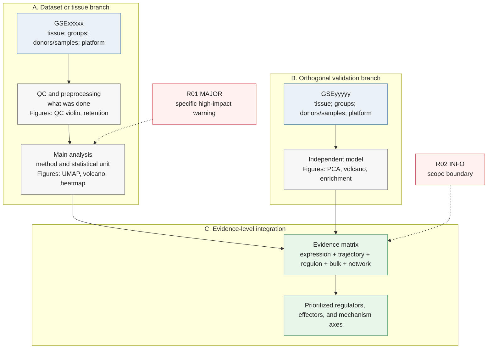

# <Project title>：分析逻辑、风险与生物学意义审查

## 1. 审查结论

用3–6句话说明：主问题、总体逻辑是否匹配、最强证据链、最高风险、当前结论性质。

## 2. 数据集与证据角色

| Dataset | Modality | Species | Tissue/region | Groups and n | Pairing/platform | Actual role | Main limitation |
|---|---|---|---|---|---|---|---|
| GSExxxxx | scRNA-seq | Human | ... | ... | ... | Discovery | ... |

## 3. Mermaid分析流程



## 4. 风险与逻辑警告

| ID | Severity | Status | Dataset/stage | Verified evidence | Risk or logic warning | Effect on conclusion | Current mitigation | Residual risk | Recommended action |
|---|---|---|---|---|---|---|---|---|---|
| R01 | MAJOR | OPEN | ... | ... | ... | ... | ... | ... | ... |

## 5. 结论—证据映射

| Claim | Evidence datasets | Statistical unit | Evidence codes | Supporting result | Discordant/missing evidence | Confidence |
|---|---|---|---|---|---|---|
| ... | ... | donor/sample | E2,E5 | ... | ... | Moderate |

## 6. 生物学意义总结

### 6.1 实际观察

- 写明数据集、细胞/组织、比较方向、效应和重复性。

### 6.2 候选基因功能

| Gene | Role in this project | Known function/context | Project evidence | Conflicting evidence | Confidence |
|---|---|---|---|---|---|
| ... | regulator/effector/marker | ... | E1,E4,E5 | ... | ... |

### 6.3 候选机制轴

```text
Upstream regulator
    ↓ E4: computationally predicted regulon edge
Candidate target or effector
    ↓ E2/E3/E5/E6/E7: expression, trajectory, validation, pathway, module
Cell state or tissue phenotype
    ↓ hypothesis requiring functional validation
Disease-associated process
```

逐条说明轴的支持证据、最弱连接、替代解释和置信度。

### 6.4 替代解释与验证

- Alternative explanation:
- Decisive perturbation/binding experiment:
- Independent cohort validation:
- Phenotypic readout:

## 7. 结论边界

- Conclusion nature: observational / association / computational inference / candidate mechanism
- Independent validation: yes / partial / no
- Causal evidence: yes / no
- Main limitation:
- Next validation:
